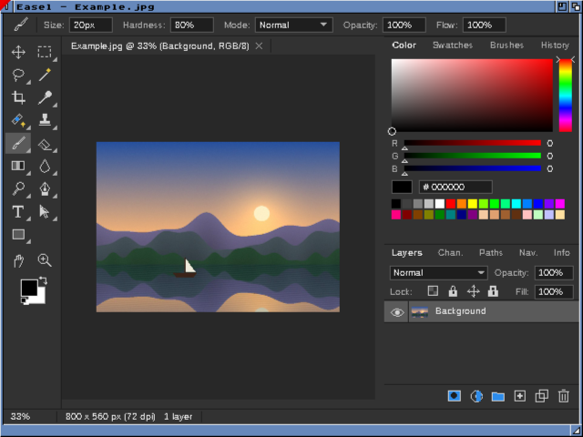
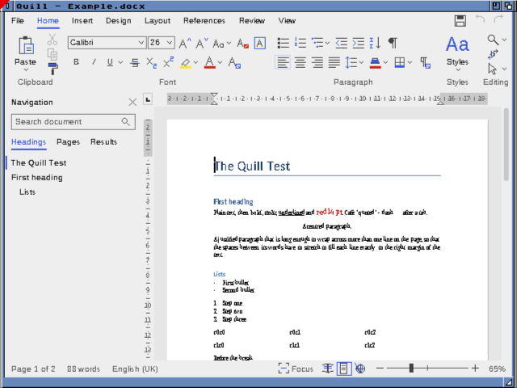
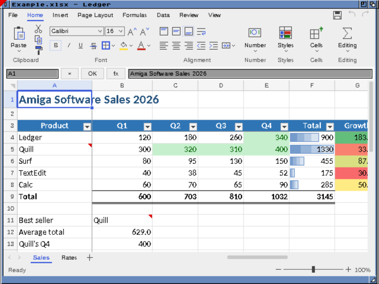
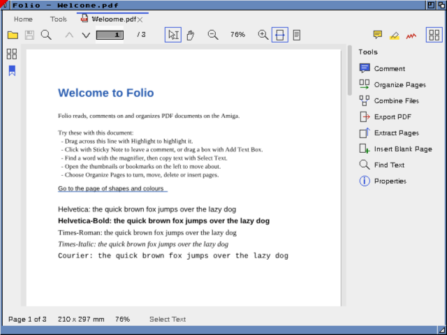
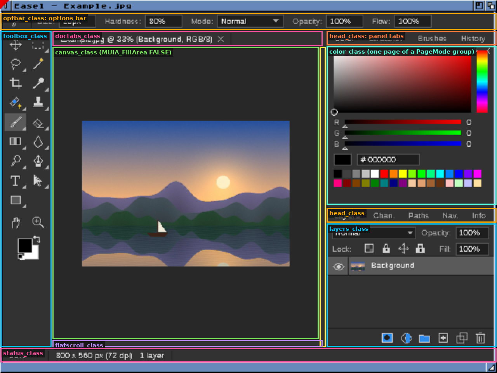
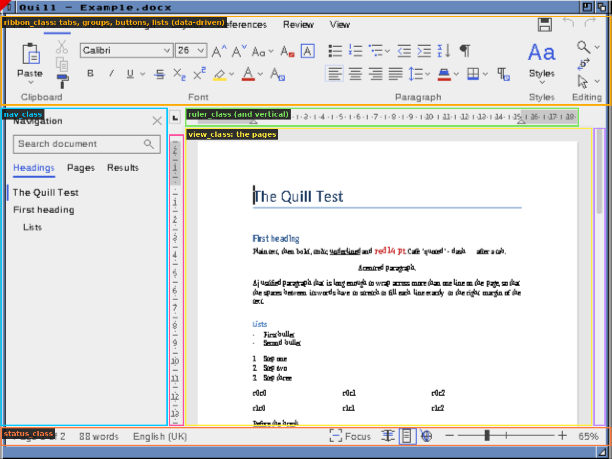
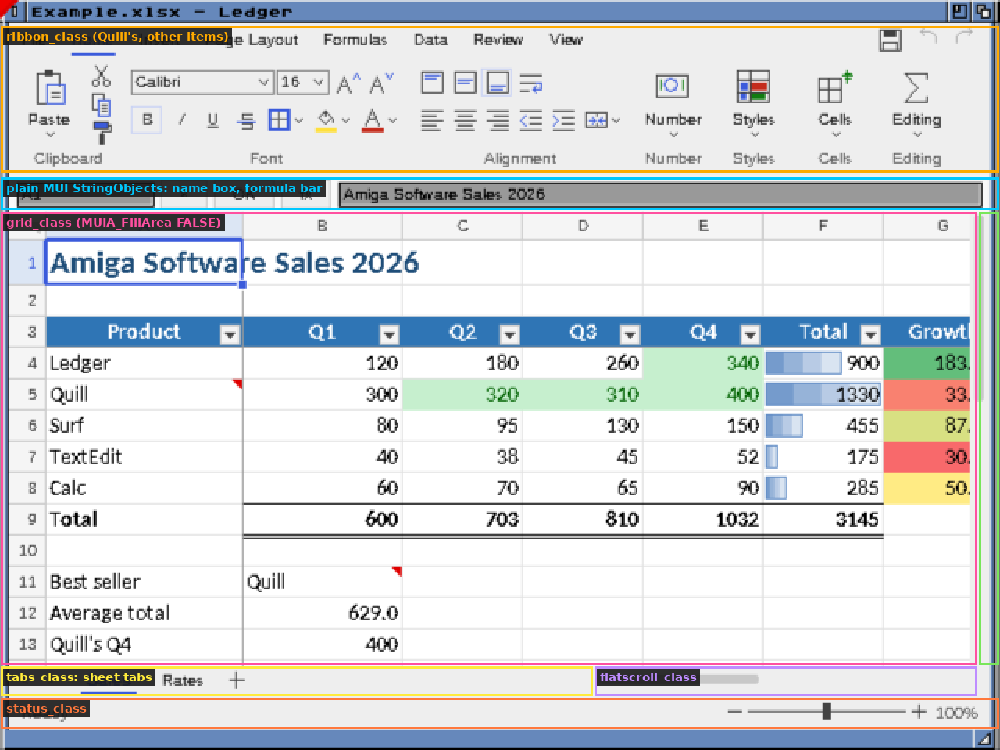
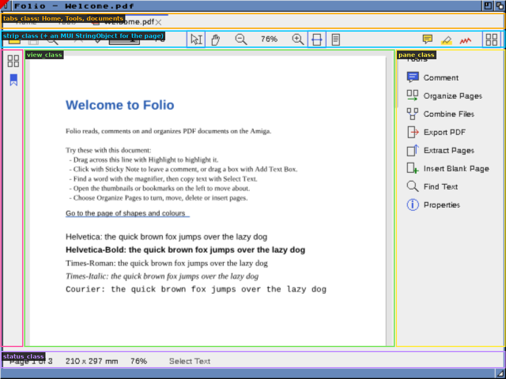

# Amiga MUI Interface Guide

How the interfaces of Easel, Quill, Ledger and Folio are built, written down so the next program
can be built the same way. Nothing here depends on what the program does. It applies equally to
a picture editor, a word processor, a game launcher or a terminal.

The approach in one paragraph: **MUI** lays the window out and runs the event loop. Everything
the user looks at most (toolbars, panels, tabs, the document view, the status bar) is a **custom
MUI class** that draws itself in a shared **theme**: a fixed set of colours obtained as pens, an
interface font of our own, and **icons drawn in code** from short vector descriptions. Dialogs use
MUI's standard gadgets with our own buttons and labels. Every command is in the **menus**, not only
on a toolbar, and every string goes through **tr()** so the interface can be translated.

Contents:

1. [Ground rules](#1-ground-rules)
2. [Toolchain and project layout](#2-toolchain-and-project-layout)
3. [MUI in five minutes](#3-mui-in-five-minutes)
4. [Starting up and shutting down](#4-starting-up-and-shutting-down)
5. [The main window](#5-the-main-window)
6. [Menus and command IDs](#6-menus-and-command-ids)
7. [The theme: colours, fonts, drawing helpers](#7-the-theme-colours-fonts-drawing-helpers)
8. [Writing a custom class](#8-writing-a-custom-class)
9. [Icons: drawing them in code](#9-icons-drawing-them-in-code)
10. [Help bubbles](#10-help-bubbles)
11. [Dialogs](#11-dialogs)
12. [Shared widgets: drop-down list, flat scroll bar, tabs](#12-shared-widgets-drop-down-list-flat-scroll-bar-tabs)
13. [Long operations: progress and Abort](#13-long-operations-progress-and-abort)
14. [Text, translation and wording](#14-text-translation-and-wording)
15. [Screens, colours and small displays](#15-screens-colours-and-small-displays)
16. [Workbench icons and packaging](#16-workbench-icons-and-packaging)
17. [Testing in the emulator](#17-testing-in-the-emulator)
18. [Pitfalls we have hit](#18-pitfalls-we-have-hit)
19. [Worked example: one toolbar button, end to end](#19-worked-example-one-toolbar-button-end-to-end)
20. [Where to look: the best real example of each technique](#20-where-to-look-the-best-real-example-of-each-technique)
21. [Checklist for a new program](#21-checklist-for-a-new-program)

Throughout, file names refer to Easel's `amiga/` directory. Quill, Ledger and Folio have the same
files under the same names (`theme.c`, `qbutton.c`, `widgets.c`, `splash.c`, `lang.c`), so look
at whichever is closest to the new program.

## The four programs at a glance

Four quite different programs, one way of building them. Each screenshot is the program's main
window on a 640 × 480 screen in the emulator, first as it looks, then with every part outlined and
labelled with the custom class that draws it. Everything outlined is our own drawing unless its
label says otherwise. The only standard MUI gadgets in a main window are the few text fields (Ledger's name box and formula
bar, Folio's page number), and they sit among the custom classes without looking out of place.

| | |
|---|---|
| **Easel** (pictures, after PhotoCraft): dark theme, toolbox, options bar, tabbed panels. | **Quill** (words, after WordCraft): light theme, ribbon, navigation pane, rulers. |
|  |  |
| **Ledger** (spreadsheets, after GridCraft): Quill's ribbon with other items, a grid. | **Folio** (PDF, after PDFCraft): tabs, tool strips, a tools pane. |
|  |  |

Labelled:



Easel. Two `head_class` tab strips each switch a `MUIA_Group_PageMode` group below them through
one notification. The canvas and its two `flatscroll_class` bars talk only through `MUIA_Prop_*`
notifications.



Quill. The ribbon is a single class drawing a table of tabs, groups and items (section 12). The view
tells the rulers about the caret paragraph with a method (`MUIM_Ruler_Set`). The File page
(`backstage_class`, not shown) is another class that covers the whole window while it is open.



Ledger. The same ribbon class as Quill's, fed different tables. The name box and formula bar are
plain MUI string gadgets in an `HGroup`, which is fine: not everything has to be custom.



Folio. One `strip_class` serves as the main toolbar, the comment and organize toolbars, the find
bar's buttons and the thin vertical strip on the left (`MUIA_Strip_Vertical`), each fed a different
item table. Section 19 follows one of its buttons through the code.

---

## 1. Ground rules

These hold for every program in the family. A new program should keep them unless there is a
good reason not to.

| Rule | Why |
|---|---|
| Every icon is our own, drawn in code (section 9). Nothing is copied or traced from another product, and no Microsoft or Adobe icons are used. | Licensing, and the look stays consistent. |
| Every command is in the menus. Toolbars, ribbons and panels are shortcuts to menu commands, not the only way in. | Amiga users expect the menus (right mouse button). It also gives each command one ID, one keyboard shortcut and one place to enable or disable it. |
| Keyboard shortcuts are shown in the menus (Amiga-key). The upstream program's Ctrl shortcuts also work where they don't clash. | Users of both systems are at home. |
| No printing and no ARexx unless the program is specifically about them. | Keeps the scope down. Neither has been asked for. |
| Every string the user sees goes through `tr()` (section 14). | Translation can be added later without touching the code. |
| The interface fits a 640 × 480 screen and adapts to larger ones (section 15). | Plenty of real Amigas run at 640 × 480 or 640 × 512. |
| The program works on a palette screen (AGA, 256 colours or fewer) as well as on a graphics card. | Not everyone has a graphics card. |
| Long operations show progress and can be aborted (section 13). | A 68040 takes seconds to minutes over things a PC does instantly. |
| Code reads like the code around it: plain C99, a comment above every function saying what it does in ordinary words, British spelling in user text ("colour"). | Others, and later sessions, have to maintain it. |

## 2. Toolchain and project layout

**Compiler:** vbcc for m68k-amigaos, NDK 3.2 headers, MUI 3.8 SDK headers. In our containers:

```sh
export VBCC=/opt/amiga/vbcc PATH=/opt/amiga/vbcc/bin:$PATH
NDK=/opt/amiga/ndk/Include_H
MUI=/opt/amiga/mui/include
vc +tools/vbcc-aos68k-fpu -c99 -O2 -cpu=68040 -fpu=68040 -I. -I"$MUI" -I"$NDK" \
   amiga/*.c core/*.c -o Program -lamiga -lm040
```

`tools/vbcc-aos68k-fpu` is a vbcc config file (copy Easel's). vbcc's C99 has limits you will run
into:

- no anonymous structs or unions;
- a cast of an expression in a macro needs its own brackets: `(APTR)(id)`, not `(APTR)id`, or
  `ID_BASE + n` is cast before the addition;
- the target is big-endian. Never read a file's integers through a pointer cast. Read them byte
  by byte.

**Layout.** Keep the program's logic portable and the Amiga parts thin:

```
core/        portable C: the document model, file formats, undo, algorithms.
             No Amiga headers. Built and tested natively (with -fsanitize=address,undefined).
amiga/       the MUI front end: main.c, the classes, theme.c, dialogs.c, lang.c ...
tests/       native tests of core/
tools/       package.sh, mkicons.py (Workbench icons), vbcc config, installer script
docs/        this guide, gap lists against the upstream program
build.sh     native tests first, then the vbcc build; "sh build.sh fast" skips the tests
```

The rule that makes this work: **the front end never computes, it only shows and asks.** Anything
that can be tested without a screen lives in `core/` and gets a native test. The front end calls
it and redraws.

**Big stacks.** A program started from the Shell gets a small stack (4 KB by default). Decoders
and recursive code need more. `amiga/bigstack.s` runs a function on a stack of our own with
exec's `StackSwap`. Copy it if you need it.

## 3. MUI in five minutes

MUI is an object-oriented toolkit built on BOOPSI, the Amiga's object system. The parts you use:

- **Objects** are made with `NewObject()` (or MUI's macros such as `VGroup, ..., End`) and freed
  with `MUI_DisposeObject()`. Disposing a parent disposes its children, so disposing the
  application frees every window and gadget in it.
- **Attributes** (`MUIA_...`) are tags. Read them with `get(obj, attr, &v)` and write them with
  `set(obj, attr, v)`. `nnset()` writes without firing notifications. Use it when you are
  updating a gadget to match the program, so it doesn't report the change back to you.
- **Methods** (`MUIM_...`) are messages: `DoMethod(obj, MUIM_Something, args...)`.
- **Notifications** connect objects without code: *when attribute A of X changes, do this to Y*.

  ```c
  /* the scroll bar moved: tell the canvas */
  DoMethod(vscroll, MUIM_Notify, MUIA_Prop_First, MUIV_EveryTime,
           (ULONG)canvas, 3, MUIM_Set, MUIA_Canvas_Top, MUIV_TriggerValue);
  /* a button released: the main loop gets ID_SAVE */
  DoMethod(button, MUIM_Notify, MUIA_Pressed, FALSE,
           (ULONG)app, 2, MUIM_Application_ReturnID, ID_SAVE);
  ```
- **Groups** lay things out: `VGroup` (stacked), `HGroup` (side by side), `ColGroup(n)` (a grid).
  Each child says how much room it needs (its *min/max*) and how much it wants of the spare room
  (`MUIA_HorizWeight`, `MUIA_VertWeight`; 0 means "only what I need"). `MUIA_Group_PageMode`
  shows one child at a time, which is how tabbed panels work.
- **Custom classes** subclass an MUI class (we always subclass `MUIC_Area`). A *dispatcher*
  function receives every method sent to the object and handles the ones it cares about (section 8).

All our own tags sit in one private range, so they never clash with MUI's:

```c
#define QTAG (TAG_USER | 0x45530000UL)          /* pick your own number per program */
#define MUIA_Canvas_Top     (QTAG + 3)
#define MUIM_Canvas_Refresh (QTAG + 0x100)
```

Give each class its own block (`+0x100`, `+0x200`, ...) and write next to each tag what it is:
`(init)` set only at creation, `(set)`, `(get)`, `(notify)` meaning others may watch it.

## 4. Starting up and shutting down

`main()` follows the same order in every program (see the end of `main.c`):

1. **Open libraries**: intuition, graphics, layers, utility, keymap (version 39), then
   `muimaster.library` 19. If MUI is missing, say so in the Shell and stop. Optional libraries
   (cybergraphics, diskfont) may fail. The code checks for `NULL` wherever it uses them.
2. **Read the arguments**: files to open, `PUBSCREEN=`, `DEBUG=file` (a log, see the `LOG()`
   macro), and `CMD=n` (run menu command n once started, which is invaluable for testing; see
   section 17). From Workbench, read `_WBenchMsg` for project icons and tooltypes.
3. **Read preferences** from `PROGDIR:Program.prefs` (plain `key=value` lines).
4. **Open the splash window** (`splash.c`): a plain Intuition window with a progress bar, shown
   while fonts are scanned and classes made. MUI isn't running yet, so it can't be an MUI window.
5. **Add our fonts drawer** to `FONTS:` (`add_fonts()`, an `AssignAdd`) and load fonts.
6. **Make every custom class.** Each class file has a `foo_class()` function that makes the class on
   first call and returns it. Call them all up front and stop with a message if any fails.
7. **Make the application object** (`ApplicationObject, MUIA_Application_Title, ... End`), then
   the main window (`win_make()`), add it with `OM_ADDMEMBER` and open it.
8. **Close the splash**, open the files given, refresh everything, and enter the loop.

The **main loop** is MUI's standard one:

```c
ULONG sigs = 0;
for (;;) {
  ULONG id = DoMethod(app, MUIM_Application_NewInput, (ULONG)&sigs);
  if (id == MUIV_Application_ReturnID_Quit || id == ID_QUIT) { if (close_all()) break; }
  else if (id == ID_CANVASCHG) refresh_panels();            /* a class told us something */
  else if (id) {                                            /* a menu command */
    set(app, MUIA_Application_Sleep, TRUE);                 /* busy pointer */
    job_begin(cur_doc(), menu_label(id));                   /* progress + Abort, section 13 */
    command(id);
    job_end();
    set(app, MUIA_Application_Sleep, FALSE);
  }
  if (sigs) { sigs = Wait(sigs | SIGBREAKF_CTRL_C); if (sigs & SIGBREAKF_CTRL_C) break; }
}
```

All commands go through one `command(ULONG id)` switch. Menus, toolbar buttons, keyboard
shortcuts and `CMD=` all reach the same code.

**Shutting down** runs in reverse: dispose the application (which frees all windows), then free
each class (`MUI_DeleteCustomClass`), free pens and fonts, remove the fonts assign, close
libraries. Each class file has a `foo_free()` for its class and any static buffers.

## 5. The main window

The window is one `WindowObject` whose contents are nested groups of custom-class objects. It
fills the screen below the title bar, as the upstream PC programs fill theirs. Easel's:

```c
win = QWindowObject,                          /* WindowObject on our public screen */
  MUIA_Window_Title, (ULONG)"Easel",
  MUIA_Window_ID, MAKE_ID('E','A','S','L'),   /* MUI remembers size and place */
  MUIA_Window_Menustrip, (ULONG)strip,
  MUIA_Window_AppWindow, TRUE,                /* icons may be dropped on it */
  MUIA_Window_Width, sw, MUIA_Window_Height, sh, MUIA_Window_LeftEdge, 0, MUIA_Window_TopEdge, top,
  WindowContents, VGroup, InnerSpacing(0, 0), MUIA_Group_Spacing, 0,
    Child, optbar = NewObject(optbar_class()->mcc_Class, NULL, MUIA_ShortHelp, (ULONG)" ", TAG_DONE),
    Child, HGroup, MUIA_Group_Spacing, 0,
      Child, toolbox = NewObject(toolbox_class()->mcc_Class, NULL, MUIA_ShortHelp, (ULONG)" ", TAG_DONE),
      Child, VGroup, MUIA_Group_Spacing, 0,
        Child, doctabs = NewObject(doctabs_class()->mcc_Class, NULL, TAG_DONE),
        Child, HGroup, MUIA_Group_Spacing, 0,
          Child, canvas = NewObject(canvas_class()->mcc_Class, NULL, MUIA_FillArea, FALSE, TAG_DONE),
          Child, vscroll = flat(0),
        End,
        Child, hscroll = flat(1),
      End,
      Child, rightcol = VGroup, MUIA_HorizWeight, 0,   /* the panels: only as wide as they need */
        Child, tophead = head(head_color),              /* tab strip ... */
        Child, toppages = VGroup, MUIA_Group_PageMode, TRUE, /* ... and the pages it switches */
          Child, colorpanel = ..., Child, swatchpanel = ..., End,
        ...
      End,
    End,
    Child, statusbar = NewObject(status_class()->mcc_Class, NULL, TAG_DONE),
  End,
End;
```

Points to copy:

- **`InnerSpacing(0, 0)` and `MUIA_Group_Spacing, 0`** everywhere in the main window. Our classes
  draw their own separators. MUI's default spacing and frames would put grey gaps between them.
- **`MUIA_ShortHelp, " "`** on any class that gives help bubbles. MUI only asks an object for
  bubble text (`MUIM_CreateShortHelp`) if it has some short help. The class then builds the real
  text for the spot under the pointer (section 10).
- **`MUIA_FillArea, FALSE`** on the document view. It paints every pixel itself, so MUI must not
  clear it first (that would flicker).
- **Wire classes with notifications** right after creating the window: each class exposes
  `(notify)` attributes such as `MUIA_Canvas_Changed`, and the main window turns them into return
  IDs for the loop, or forwards them straight to another object.
- **One window, panels inside it.** Floating tool windows are for things the user opens on
  purpose (a palette, brush settings). The main work happens in one window that fills the screen.

## 6. Menus and command IDs

**IDs.** All command IDs live in `ids.h`, in blocks per menu with explicit starts, so adding
an item never shifts another menu's numbers (saved shortcut files and `CMD=n` refer to them):

```c
enum {
  ID_NEW = 100, ID_OPEN, ID_CLOSE, ID_SAVE, ...        /* File */
  ID_UNDO = 200, ID_REDO, ID_CUT, ID_COPY, ...         /* Edit */
  ID_ZOOMIN = 700, ...                                 /* View */
  ID_CANVASCHG = 900, ID_POINTER, ...                  /* not menu items: classes reporting */
  ID_DLGOK = 1000, ID_DLGCANCEL, ID_DLGCHANGE, ...     /* inside dialogs */
};
```

New items go at the end of their block. Check after a merge that no block has run into the next
one: compile a three-line program that prints the last ID of each block.

**The menu table** is a `struct NewMenu` array written with short macros, so it reads like the
menu itself:

```c
#define M(title)          { NM_TITLE, (STRPTR)title, 0, 0, 0, 0 }
#define I(label, key, id) { NM_ITEM, (STRPTR)label, (STRPTR)key, 0, 0, (APTR)(id) }
#define H(label)          { NM_ITEM, (STRPTR)label, 0, 0, 0, 0 }      /* has a submenu */
#define S(label, key, id) { NM_SUB, (STRPTR)label, (STRPTR)key, 0, 0, (APTR)(id) }
#define T(label, key, id) { NM_ITEM, (STRPTR)label, (STRPTR)key, CHECKIT | MENUTOGGLE, 0, (APTR)(id) }
#define BAR               { NM_ITEM, NM_BARLABEL, 0, 0, 0, 0 }
#define SBAR              { NM_SUB, NM_BARLABEL, 0, 0, 0, 0 }

static struct NewMenu menus[] = {
  M("File"),
  I("New...", "N", ID_NEW), I("Open...", "O", ID_OPEN),
  H("Open Recent"), S("1", 0, ID_RECENT0), ..., SBAR, S("Clear Recent List", 0, ID_CLEARRECENT),
  BAR,
  I("Save", "S", ID_SAVE), I("Save As...", 0, ID_SAVEAS),
  ...
  { NM_END, 0, 0, 0, 0, 0 }
};
Object *strip = MUI_MakeObject(MUIO_MenustripNM, (ULONG)menus, 0);
```

Conventions:

- **"..."** after a label means the item opens a dialog before doing anything.
- **Menu titles and order follow the upstream program** (File, Edit, Image, Layer, Select,
  Filter, View, Window for Easel). Users coming from it find things where they expect.
- **Disable, don't hide.** `update_menus()` runs after every change and sets `MUIA_Menuitem_Enabled`
  through `DoMethod(strip, MUIM_FindUData, id)`. Items that need a document are disabled when none
  is open. A command must also check for itself, because `CMD=` and shortcuts bypass the menu.
- **Dynamic labels** (recent files) are set with `MUIA_Menuitem_Title` on the found item.
- `menu_label(id)` finds an item's label in the table. The progress window uses it to say
  what is running.
- **Keyboard shortcut editor** (Easel 0.8, `keys.c`): reads the command list from the same
  table, so new items appear in it automatically.

## 7. The theme: colours, fonts, drawing helpers

`theme.h`/`theme.c` is the heart of the look. Every custom class draws through it and never
picks its own colours or fonts.

**Colours are tokens, not RGB.** The theme has a list of named colours (`T_PANEL`, `T_TEXT`,
`T_ACCENT`, `T_HOVER`, `T_BORDER`, ...). There are two tables of RGB values, one light and one
dark, taken from the upstream program's design tokens:

```c
enum { T_RIBBON, T_TABSTRIP, T_CANVAS, T_PANEL, T_BORDER, T_BORDER2, T_TEXT, T_DIM, T_DISABLED,
       T_ICON, T_HOVER, T_PRESSED, T_CHECKED, T_ACCENT, T_WHITE, ..., T_NPENS };
static const ULONG light[T_NPENS] = { 0xF9F9F9, 0xF0F0F0, ... };
static const ULONG dark[T_NPENS]  = { 0x323232, 0x262626, ... };
```

A class asks for `tpen(T_PANEL)` and gets a pen number for the current screen. Adding a colour
means adding a token to the enum and a value to *both* tables. Never write an RGB value in a class.

**Pens.** On the first `MUIM_Setup` of any themed object, `theme_setup()` calls
`ObtainBestPen()` for every token on that screen (precision `PRECISION_GUI`). On a palette screen
this shares existing pens or takes free ones, and degrades to the nearest colour when the palette
is full. The last `MUIM_Cleanup` releases them all with `ReleasePen()`. Every pen taken must go
back, or other programs run short. Switching light/dark (`theme_set_dark()`) releases and takes
the pens again. Each object then just redraws.

MUI can send an object `MUIM_Setup` twice, or `MUIM_Cleanup` without `MUIM_Setup`, when groups are
hidden and shown. `theme_setup()` therefore keeps a table of the objects set up and counts each
once. Always use `theme_setup()`/`theme_cleanup()` in pairs rather than counting yourself.

**Fonts.** The interface uses a bitmap font of our own (QuillSans, made from Liberation Sans by
`quill/tools/mkamigafonts.py`), at 11 pixels (15 for "large text"), plus bold, a big size for
headings and a small one for ruler numbers:

```c
struct TextFont *theme_font(void), *theme_bold(void), *theme_big(void), *theme_small(void);
```

They never return `NULL`: each falls back to the next, ending at the system default font, so a
missing Fonts drawer makes the program plainer, not broken (it warns once at start). The fonts are
loaded by our own hunk loader in `theme.c`, not `OpenDiskFont()`, because some diskfont.library
versions won't open fonts from the program's drawer. A rendering of an OFL font must not carry
the original name, hence "QuillSans" instead of "Liberation Sans".

**Drawing helpers.** Classes draw with these, never with raw `SetAPen`/`Text` for text:

```c
LONG theme_textlen(rp, tf, s);                 /* width of tr(s) in tf */
void theme_text(rp, tf, x, y, s, pen);         /* tr(s), top at y (not baseline), JAM1 */
void theme_rect(rp, x0, y0, x1, y1, pen);      /* 1-pixel outline, corners inclusive */
void theme_fill(rp, x0, y0, x1, y1, pen);      /* filled box, corners inclusive */
void theme_icon(rp, icon, x, y, size, dim);    /* section 9 */
```

`theme_text` and `theme_textlen` call `tr()` themselves, so a class that draws a label is
translated without doing anything. Coordinates are always inclusive on both ends, and text is
placed by its top edge. This avoids off-by-one and baseline confusion across classes.

**The look itself**, matching the upstream PC programs:

- Flat. No 3D bevels, no MUI frames inside the main window. Areas are separated by a single
  `T_BORDER` line.
- Hover is a filled `T_HOVER` box, pressed or chosen a `T_PRESSED` box. Accent colour (`T_ACCENT`)
  only for the one thing that is "on" (the current tab underline, a checked toggle), never
  decoration.
- Text in `T_TEXT`, secondary text in `T_DIM`, disabled in `T_DISABLED`.
- Spacing in whole pixels derived from the font height (`fh() + 8` for a row and so on), so large
  text scales the layout.
- The dark theme is the default for Easel (pictures look right on dark grey). The office programs
  default to light.

## 8. Writing a custom class

Every visible part (toolbox, panel, tab strip, status bar, canvas) is a subclass of `MUIC_Area`
written in the same shape. Here is the whole skeleton of a class, a small clickable strip of
labels, ready to copy:

```c
/* strip.c - a row of labels; clicking one makes it the active one */
#define MUIA_Strip_Labels (QTAG + 0x900)   /* (init) const char *const *, NULL-ended */
#define MUIA_Strip_Active (QTAG + 0x901)   /* (set, get, notify) the label chosen */

struct SData {                             /* one per object: INST_DATA(cl, obj) */
  struct MUI_EventHandlerNode ehn;         /* for mouse events */
  const char *const *labels; int n, active, hot, shown;
};
static struct MUI_CustomClass *scls;

/* the label under x, or -1 */
static int hit(struct SData *d, Object *obj, LONG x)
{
  LONG lx = _mleft(obj);
  int i;
  for (i = 0; i < d->n; i++) {
    LONG w = theme_textlen(_rp(obj), theme_font(), d->labels[i]) + 20;
    if (x >= lx && x < lx + w) return i;
    lx += w;
  }
  return -1;
}
static void draw(struct SData *d, Object *obj)
{
  struct RastPort *rp = _rp(obj);
  LONG x = _mleft(obj);
  int i;
  theme_fill(rp, _mleft(obj), _mtop(obj), _mright(obj), _mbottom(obj), tpen(T_TABSTRIP));
  for (i = 0; i < d->n; i++) {
    LONG w = theme_textlen(rp, theme_font(), d->labels[i]) + 20;
    if (i == d->active) theme_fill(rp, x, _mtop(obj), x + w - 1, _mbottom(obj), tpen(T_PRESSED));
    else if (i == d->hot) theme_fill(rp, x, _mtop(obj), x + w - 1, _mbottom(obj), tpen(T_HOVER));
    theme_text(rp, theme_font(), x + 10, _mtop(obj) + 4, d->labels[i], tpen(i == d->active ? T_TEXT : T_DIM));
    x += w;
  }
}
static ULONG sdispatch(__reg("a0") struct IClass *cl, __reg("a2") Object *obj, __reg("a1") Msg msg)
{
  struct SData *d;
  switch (msg->MethodID) {
  case OM_NEW:
    if (!(obj = (Object *)DoSuperMethodA(cl, obj, msg))) return 0;
    d = INST_DATA(cl, obj);
    memset(d, 0, sizeof *d);
    d->hot = -1;
    d->labels = (const char *const *)GetTagData(MUIA_Strip_Labels, 0, ((struct opSet *)msg)->ops_AttrList);
    while (d->labels && d->labels[d->n]) d->n++;
    d->ehn.ehn_Object = obj; d->ehn.ehn_Class = cl;
    d->ehn.ehn_Events = IDCMP_MOUSEBUTTONS | IDCMP_MOUSEMOVE;
    return (ULONG)obj;
  case OM_SET: {
    struct TagItem *t = FindTagItem(MUIA_Strip_Active, ((struct opSet *)msg)->ops_AttrList);
    d = INST_DATA(cl, obj);
    if (t && d->active != (int)t->ti_Data) { d->active = (int)t->ti_Data; if (d->shown) MUI_Redraw(obj, MADF_DRAWOBJECT); }
    break;                                 /* on to Area, which sends the notifications */
  }
  case OM_GET:
    if (((struct opGet *)msg)->opg_AttrID == MUIA_Strip_Active) {
      *((struct opGet *)msg)->opg_Storage = (ULONG)((struct SData *)INST_DATA(cl, obj))->active;
      return TRUE;
    }
    break;
  case MUIM_AskMinMax: {                   /* Area adds its frame first, then our room goes on top */
    struct MUIP_AskMinMax *m = (struct MUIP_AskMinMax *)msg;
    LONG h = theme_font()->tf_YSize + 8;
    DoSuperMethodA(cl, obj, msg);
    m->MinMaxInfo->MinWidth += 60; m->MinMaxInfo->DefWidth += 240; m->MinMaxInfo->MaxWidth += MUI_MAXMAX;
    m->MinMaxInfo->MinHeight += h; m->MinMaxInfo->DefHeight += h; m->MinMaxInfo->MaxHeight += h;
    return 0;
  }
  case MUIM_Setup:                         /* we have a screen: pens, fonts, events */
    if (!DoSuperMethodA(cl, obj, msg)) return FALSE;
    theme_setup(obj);
    theme_handler(obj, &((struct SData *)INST_DATA(cl, obj))->ehn);
    return TRUE;
  case MUIM_Cleanup:                       /* the screen is going: give it all back */
    theme_cleanup(obj);                    /* (also removes the event handler) */
    break;
  case MUIM_Show: ((struct SData *)INST_DATA(cl, obj))->shown = 1; break;
  case MUIM_Hide: ((struct SData *)INST_DATA(cl, obj))->shown = 0; break;
  case MUIM_Draw:
    DoSuperMethodA(cl, obj, msg);
    if (((struct MUIP_Draw *)msg)->flags & (MADF_DRAWOBJECT | MADF_DRAWUPDATE)) draw(INST_DATA(cl, obj), obj);
    return 0;
  case MUIM_HandleEvent: {
    struct IntuiMessage *im = ((struct MUIP_HandleEvent *)msg)->imsg;
    int in, i;
    d = INST_DATA(cl, obj);
    if (!im || !d->shown) return 0;
    in = im->MouseX >= _mleft(obj) && im->MouseX <= _mright(obj) && im->MouseY >= _mtop(obj) && im->MouseY <= _mbottom(obj);
    i = in ? hit(d, obj, im->MouseX) : -1;
    if (im->Class == IDCMP_MOUSEMOVE) {    /* hover: redraw only when it changes */
      if (i != d->hot) { d->hot = i; MUI_Redraw(obj, MADF_DRAWOBJECT); }
      return 0;                            /* others may want moves too */
    }
    if (im->Class == IDCMP_MOUSEBUTTONS && im->Code == SELECTDOWN && i >= 0) {
      SetAttrs(obj, MUIA_Strip_Active, i, TAG_DONE);   /* through OM_SET, so notifications go */
      return MUI_EventHandlerRC_Eat;       /* ours: nobody else gets this click */
    }
    return 0;
  }
  }
  return DoSuperMethodA(cl, obj, msg);
}
struct MUI_CustomClass *strip_class(void)
{
  if (!scls) scls = MUI_CreateCustomClass(NULL, (STRPTR)MUIC_Area, NULL, sizeof(struct SData), (APTR)sdispatch);
  return scls;
}
void strip_class_free(void) { if (scls) { MUI_DeleteCustomClass(scls); scls = NULL; } }
```

The rules behind the skeleton:

- **The dispatcher signature** is `ULONG f(__reg("a0") struct IClass *cl, __reg("a2") Object *obj,
  __reg("a1") Msg msg)` (vbcc's register syntax). BOOPSI passes class, object and message in
  those registers.
- **Pass on what you don't handle**: `return DoSuperMethodA(cl, obj, msg)` at the end. Where you
  handle a method but Area must also see it (`OM_SET`, `MUIM_Cleanup`, `MUIM_Show`), `break`
  instead of returning.
- **Only draw in `MUIM_Draw`.** To redraw, call `MUI_Redraw(obj, MADF_DRAWOBJECT)`. Never draw
  from a method or event directly, and never when `shown` is 0: a hidden object (a panel page not
  in front) has no place on the window and would draw over something else. Track `MUIM_Show` and
  `MUIM_Hide` in a `shown` flag in every class.
- **Draw inside `_mleft.._mright`, `_mtop.._mbottom`** (the area inside the frame). `_rp(obj)`
  is the rastport, `_screen(obj)`, `_win(obj)`, `_window(obj)`, `_app(obj)` the rest of the context,
  valid between `MUIM_Setup` and `MUIM_Cleanup`.
- **Size with `MUIM_AskMinMax`**: call the superclass first, then *add* your sizes. Base sizes
  on the font height so large text works. `MUI_MAXMAX` for "as big as you like".
- **Events with an event handler node** (`MUIM_Window_AddEventHandler`), added in `MUIM_Setup` and
  removed in `MUIM_Cleanup`. `theme_handler()`/`theme_cleanup()` do both. Return
  `MUI_EventHandlerRC_Eat` only for events that are yours (a click inside you, a drag you started),
  so other objects still get mouse moves. Ask for `IDCMP_RAWKEY` too if the class takes keys.
- **Report outward with attributes, not calls.** The class sets a `(notify)` attribute
  (`SetAttrs(obj, MUIA_Strip_Active, i, TAG_DONE)`) and main.c decides what that means. That keeps
  classes reusable and the program's logic in one place. For "something happened" with no value,
  set the attribute to `TRUE` each time and answer `OM_GET` with `TRUE`; `MUIV_EveryTime`
  notifications fire on every set.
- **Take orders with methods**: `MUIM_Foo_Refresh` (redraw from the program's current state) is
  the usual one. Classes read the program's state (current document, tool, colours) through
  plain functions such as `cur_doc()` rather than keeping copies that can drift.
- **Timers**: an input handler node with `MUIIHNF_TIMER` and `ihn_Method` set, added with
  `MUIM_Application_AddInputHandler`. MUI then sends that method every `ihn_millis` ms. Easel's
  canvas uses a 250 ms timer for the marching selection outline and a faster one only while a
  brush stroke needs it. Remove it in `MUIM_Cleanup`.
- **Pushing work for later**: inside an event, `DoMethod(_app(obj), MUIM_Application_PushMethod,
  target, n, method, ...)` runs the method once the current input has been handled. Use it when
  acting now would dispose or close the thing being clicked (closing a pop-up list from its own
  click, for example).
- **Repeated macros**: where several classes share `MUIM_Setup`/`Cleanup`/`Show`/`Hide` exactly,
  a `PANEL_COMMON(T)` macro (see `panels.c`) stamps the four cases out.

**A document view** (the canvas) adds to this:

- It keeps an off-screen RGB copy of what is visible and blits it, so redraws don't recompute
  the document. Only the changed rectangle is recomposed (`MUIM_Canvas_Update` with a box).
- Rubber bands, outlines and cursors are drawn in `COMPLEMENT` mode, so drawing them a second time
  removes them without a redraw underneath.
- On a graphics card pixels go out with cybergraphics' `WritePixelArray`. On a palette screen they
  are dithered to a cube of pens (`draw_rgb()` in `widgets.c`, section 15).

## 9. Icons: drawing them in code

No icon is a bitmap. Each is a short string of drawing commands on a **16 × 16 grid**, interpreted
by `theme_icon()` at any size, in the theme's colours, light or dark, normal or dimmed. This keeps
the icons ours, makes them scale to large text, and means a new icon is one line of text.

### The language

| Command | Meaning |
|---|---|
| `cX` | colour for what follows: `i` icon (the normal ink), `a` accent, `r` red, `g` green, `o` orange, `y` yellow, `d` dim grey, `w` white (paper), `l` light grey, `t` text, `s` selection blue |
| `L x0 y0 x1 y1` | line |
| `R x0 y0 x1 y1` | rectangle outline |
| `F x0 y0 x1 y1` | filled rectangle |
| `O cx cy r` | circle outline |
| `E cx cy r` | filled circle |
| `P n x0 y0 x1 y1 ...` | polyline through n points (repeat the first point to close it) |
| `B text`, `I text`, `U text` | a few letters in the bold, italic or underlined interface font, centred |

Coordinates run 0 to 15, left to right and top to bottom. The interpreter multiplies by
`size / 16`. Filled boxes grow slightly at large sizes so strokes keep their weight.

### Examples

```c
/* CUT: two finger rings and crossed blades */
"ci O 4 12 2 O 11 12 2 L 5 10 11 1 L 10 10 4 1",
/* COPY: two overlapping sheets, the front one with lines of text */
"ci R 2 1 9 11 cw F 3 2 8 10 ca R 6 5 13 15 cw F 7 6 12 14 ci L 8 8 11 8 L 8 10 11 10 L 8 12 11 12",
/* BULLETS: three dots and three lines */
"ci E 2 3 1 E 2 8 1 E 2 13 1 L 5 3 14 3 L 5 8 14 8 L 5 13 14 13",
/* T_REDEYE: an eye with a red pupil */
"ci P 9 1 8 4 4 8 3 12 4 15 8 12 12 8 13 4 12 1 8 cr E 8 8 2 cw F 9 7 9 7",
```

Notice the layering in COPY: outline in ink (`ci R`), then the sheet's paper filled white inside
it (`cw F`), then the next sheet on top in the accent colour, again filled white, then the text
lines. Draw back to front. Use white fills to make shapes opaque.

### Adding an icon

1. Add `IC_NAME` to the enum in `theme.h`, at the end of your program's block. Some code maps
   ranges arithmetically, e.g. Easel's `TOOL_ICON(t)` is `IC_T_PATTERN + (t - TL_PATTERN)`. If
   you add to such a range, keep the enum order and the tool order in step.
2. Add the string to `icons[]` in `theme.c` **at the same position**, with a comment saying what
   it pictures: `/* T_PATCH: patch: a dashed area and the patch stitched over it */ "..."`.
   Position, not name, connects the two, so a missing line shifts every icon after it. Count.
3. Draw it on paper first, or in a 16 × 16 grid in any editor, then type the coordinates.
4. Look at it in the emulator at 16 px and at the large size, in both themes, and dimmed.

### Style rules for icons

- **Outline in `ci`, one accent at most.** Most icons are ink lines with one part in the accent
  or a meaningful colour (red for delete or record, green for go, yellow for highlight). A
  rainbow icon reads badly at 16 pixels on a palette screen.
- **Metaphors, not logos.** Scissors for cut, a folder for open, a camera for a snapshot. Never
  reproduce a product's icon, even approximately. If the upstream program has a famous icon for
  something, draw the plain object instead.
- **1-pixel lines on the grid.** Diagonals at 45° or shallow slopes, and avoid detail finer than
  2 grid units, because at 16 px each unit is one pixel.
- **Leave a 1-unit margin** (use 1 to 14) so icons don't touch their neighbours.
- **Dimmed** (`dim=1`) turns every colour but white into `T_DISABLED`, so an icon must still read
  as one grey shape. Don't rely on colour alone to tell two icons apart.
- **One-colour use**: `theme_icon_pen()` draws an icon entirely in one pen (white on a blue page,
  for example). Its white parts become the accent so they stay visible.

## 10. Help bubbles

Every button, field and tool explains itself when the pointer rests on it, in the same format:
**name in bold** (with its shortcut), then one or two plain sentences saying what it does.

```c
const char *theme_bubble(const char *name, const char *body);  /* "\33bName\33n\nbody wrapped at 46" */
```

A class that draws several things gets bubbles for each of them like this:

```c
case MUIM_CreateShortHelp: {
  struct MUIP_CreateShortHelp *m = (struct MUIP_CreateShortHelp *)msg;
  int h = hit(d, obj, m->mx, m->my);                   /* what is under the pointer */
  if (h < 0) return 0;                                 /* nothing: no bubble */
  snprintf(name, sizeof name, "%s (%c)", tr(tool_names[h]), tool_keys[h]);
  return (ULONG)theme_bubble(name, tr(tool_help[h]));
}
case MUIM_DeleteShortHelp: return 0;                   /* the text is static: nothing to free */
```

(remember `MUIA_ShortHelp, " "` at creation, section 5). Write the help text as a table next to
the names, in the same order, so it is easy to keep complete. Wording: say what it does in the
user's terms ("Fills the area of similar colour where you click with the foreground colour."),
not how ("Runs a flood fill").

Bubbles can be turned off in preferences (`theme_tips = 0` makes `theme_bubble` return `NULL`).

## 11. Dialogs

Dialogs use MUI's own gadgets (sliders, strings, cycles, check marks, lists) with three things of
ours, so they match the main window:

- **`QButton(label)`** (`qbutton.c`): a flat button in the theme, label in the dialog font, with
  the letter after `_` underlined and made its keyboard shortcut (`"_Reset"`: R presses it, through
  `MUIA_ControlChar`).
- **`QLabel(label, flags)`** and **`QTitleObject(title)`**: labels and section titles drawn in the
  theme's text colour. MUI's own labels are black, which can't be read on the dark theme.
- **`QDLG`**: a tag pair for the dialog's root group, setting the dialog font and the theme's
  background.

**The modal pattern.** All dialogs are built and run the same way:

```c
Object *w = dialog_window("Image Size", VGroup,          /* title, contents, OK label */
    Child, ColGroup(2),
      Child, QLabel(tr("Width"), MUIO_Label_Centered),  Child, wstr = string_num(d->w),
      Child, QLabel(tr("Height"), MUIO_Label_Centered), Child, hstr = string_num(d->h),
    End,
  End, NULL);
static const ULONG ends[] = { ID_DLGOK, 0 };
if (run_modal(w, ends, NULL) == ID_DLGOK) { ...read the gadgets, call the core... }
MUI_DisposeObject(w);
```

- `dialog_window()` adds the OK and Cancel buttons (right-aligned, OK first), centres the window
  on the main one and wires the buttons to `ID_DLGOK`/`ID_DLGCANCEL`.
- `run_modal()` adds the window to the application, puts the main window to sleep, opens the
  dialog and runs its own input loop until one of the `ends` IDs arrives (Cancel, Esc and the close
  gadget all give `ID_DLGCANCEL`). Then it closes the window and **redraws the main window**
  (section 18). The optional `each(id)` callback sees every other ID, and `0` when idle. Live
  previews hang off that.
- Read values after the loop, then dispose the window. Never keep dialog objects between uses.

**Live previews.** Adjustment and filter dialogs show the result on the document as the sliders
move, and Cancel takes it back. The trick is undo: each preview is applied as one undo step, and
the step from the previous preview is discarded first.

```c
/* sliders notify ID_DLGCHANGE; each() just notes it, and applies when idle (id == 0), so
   dragging a slider doesn't queue up a dozen slow re-renders */
static void sd_each(ULONG id)
{
  if (id == ID_DLGCHANGE) { pending = 1; return; }
  if (id == 0 && pending) { pending = 0; pv_drop(&pv); apply(); pv_done(&pv); }
}
```

On OK the last preview simply stays as the step. On Cancel `pv_drop()` discards it. A "Preview"
check box and a "Reset" button (back to `MUIA_Numeric_Default`) complete it. `slider_dialog()` in
`dialogs.c` packages all this: give it a title, a table of `{ label, min, max, default }` and an
apply function, and you get a complete dialog.

**Small requesters** for one value or a question:

```c
int ask(const char *gadgets, const char *fmt, const char *arg);   /* MUI_Request, "OK|Cancel" */
int ask_string(const char *title, const char *label, char *buf, int cap);
int ask_number(const char *title, const char *label, LONG *v, LONG min, LONG max);
```

**File requesters** are ASL (`MUI_AllocAslRequestTags`), starting in the drawer of the current
file, with the pattern for the format.

**Layout conventions**: labels right-aligned in a `ColGroup(2)` beside their gadgets; the gadget
that matters most first; units after the field ("px", "%"); OK and Cancel bottom right; no
dialog taller than 480 pixels (split into pages with a `RegisterGroup` if needed).

## 12. Shared widgets: drop-down list, flat scroll bar, tabs

`widgets.c` holds the small pieces several classes need. Use these rather than MUI's equivalents
inside themed areas:

- **`popup_list(owner, x, y, w, labels, n, cur, attr)`**: a borderless window below a point,
  listing labels in the theme. The choice comes back as `set(owner, attr, index)`, pushed so it
  arrives after the list has closed. Used for every drop-down in toolbars and panels. It closes
  when it loses activation and repairs the window it lay over.
- **`flatscroll_class()`**: a thin, flat scroll bar that speaks MUI's `MUIA_Prop_Entries`,
  `_Visible` and `_First`, so it is a drop-in for a `PropObject` and can be wired with the same
  notifications. Pass `MUIA_FlatScroll_Horiz, TRUE` for a horizontal one.
- **Panel tabs** (`head_class()` in `panels.c`): a strip of labels whose `MUIA_Head_Active` is
  notified straight into a page group's `MUIA_Group_ActivePage`. No code in main.c:

  ```c
  DoMethod(tophead, MUIM_Notify, MUIA_Head_Active, MUIV_EveryTime,
           (ULONG)toppages, 3, MUIM_Set, MUIA_Group_ActivePage, MUIV_TriggerValue);
  ```
- **Scrub fields** (options bar, `toolbox.c`): a number you drag left and right to change, or
  click to type. It is drawn by the bar itself, not a gadget, and described by a table:

  ```c
  SCRUB("Size", opt.size[t], 1, 2500, "px");   CHOICE("Mode", opt.blend[t], blendlist, BM_N);
  CHECK("Anti-alias", opt.aa[t]);              BUTTON("Reset", ID_RESETTOOL);
  ```
  Bars and ribbons that are described as data are the pattern to follow. Quill's and Ledger's
  ribbon is a table of tabs → groups → items `{ kind, size, icon, label, id, help }`, and the class
  lays it out and draws it. Adding a button is adding a line.

## 13. Long operations: progress and Abort

Anything that can take more than half a second must report progress and must be abortable.

**In the core** (portable, no Amiga code), slow loops call a hook once a row or so:

```c
extern int (*progress_hook)(long done, long total);
int  progress(long done, long total);   /* returns nonzero once Abort was pressed */
long progress_push(long lo, long hi);   /* this stage is lo..hi thousandths of the whole */
void progress_pop(long saved);

for (y = y0; y < y1 && !progress(y - y0, y1 - y0); y++) { ...one row... }
```

With no hook set, `progress()` is a single test, so tests and batch tools pay nothing.

**In the front end** (`jobs.c`), every menu command runs as a *job*: `job_begin()` sets the hook
and notes the top undo step, `job_end()` clears it. If the operation passes half a second, a small
"Working" window opens with the command's name, a gauge and Abort. Each `progress()` call moves the
gauge (at most ten times a second) and lets MUI handle that window's input with
`MUIM_Application_InputBuffered`. Esc is read straight from the keyboard matrix, so it works even
when the main window is active. On Abort the core stops, and `job_end()` takes back the partial undo
step, leaving the document exactly as it was.

Three rules make this safe:

1. Every operation that changes the document starts an undo step *before* it changes anything,
   so there is always something to take back.
2. A loop that stops early must leave memory consistent (free what it allocated, no
   half-written pointers). The undo restores the pixels, not the program's structures.
3. Previews in dialogs run with the window's own job (`job_begin(doc, NULL)`), so an aborted
   preview leaves nothing behind.

## 14. Text, translation and wording

**`tr()`.** Strings are written in English in the code and passed through `tr()` where they are
shown. `lang.c` looks them up (binary search on the English) in `lang_table.h`, which
`tools/mklang.py` generates from the list of rows it holds: English as the C source writes it, then
German, French, Spanish and Italian (Quill has the full tool). Missing translations fall back to
English, so new strings can be added before they are translated. Text is Latin-1 throughout
(`\374` for ü in C strings).

- Drawn text: `theme_text()` and `theme_textlen()` call `tr()` for you.
- Gadgets, menus and window titles: call `tr()` when building them. Menu labels are translated
  when the strip is made.
- Don't build sentences from pieces ("Delete " + n + " layers"). Translate a whole format string
  (`tr("Delete %ld layers?")`) and fill it in.

**Wording**, which matters as much as the drawing:

- Name commands as the upstream program does, so its manuals and tutorials apply.
- Say what happens, in plain words: "Abort puts the picture back as it was", not "Operation
  cancelled, state restored".
- Messages give the reason and what to do: "There isn't enough memory for that. A 2000 × 1500
  picture needs 12 MB; 6 MB is free."
- Title case for commands and buttons ("Save As...", "Load Selection"), sentence case for
  descriptions and help.
- British spelling in user text (colour, centre, grey). Keep the upstream's spelling only in
  command names that users would search for ("Color Range").

## 15. Screens, colours and small displays

**Screens.** The main window opens on a public screen: Workbench by default, `PUBSCREEN=` or a
tooltype to choose another, and (Easel 0.8) optionally a screen of the program's own (window,
own public screen, or full screen). Wrap `WindowObject` in a macro that adds
`MUIA_Window_PublicScreen` when a screen is named, and use it for every window and dialog so they
all appear on the same screen:

```c
#define QWindowObject WindowObject, (ULONG)(pub_screen[0] ? MUIA_Window_PublicScreen : TAG_IGNORE), (ULONG)pub_screen
```

**Colour depth.** Two paths for document pixels, chosen per screen:

- **True colour** (depth > 8 and cybergraphics.library present): `WritePixelArray` with RGB rows.
  Exact.
- **Palette screen**: a cube of pens (6 levels per channel on 8 bits, 3 on 5–7 bits, 2 below)
  obtained with `ObtainBestPen(... PRECISION_IMAGE)`, and an ordered (Bayer) dither to it, written
  with `WriteChunkyPixels`. `draw_rgb()` and `draw_rgb_box()` in `widgets.c` do both.

Interface colours always go through the theme's pens (section 7), never the cube.

**Small displays.** Test at 640 × 480 and 640 × 512 as well as at 800 × 600 and larger. The
classes adapt in `MUIM_Setup`, where the screen is known:

- Easel's toolbox becomes two columns when one column wouldn't fit (under 700 lines since it has
  19 groups). Work the threshold out from the content, and revisit it whenever tools are added.
- An options bar or toolbar must not depend on its last fields being visible: at 640 pixels the
  tail can be cut off, so every setting it holds must also be in a menu or dialog.
- Panels share space through tabs, and the less-used ones go behind tabs on short screens.
- Thumbnails and rows shrink (Layers panel rows 18 or 28 pixels).
- Long tab labels switch to short forms when they don't fit.

Tab (as in the upstream programs) hides and shows all panels to give the document the whole window.

## 16. Workbench icons and packaging

**Workbench icons** for the package (drawer, program, installer, README, examples) are drawn by
`tools/mkicons.py` with Python's PIL at four times the size and scaled down, and written as
`.info` files with two images: a GlowIcon (OS 3.5+, AROS) and the classic four-colour image for
Workbench 2.x–3.1. The same rules as the interface icons apply: original pictures, no copied logos.
It also writes PNG previews to check them by eye.

A program that saves documents may write a GlowIcon beside each file it saves (Easel does, with a
thumbnail of the picture), only when there isn't one already, and only if the preference is on.

**Packaging** (`tools/package.sh <version> <outdir>`) assembles the drawer: program, fonts drawer,
TrueType drawer if used, README, licences, installer script, examples, icons, then makes the
`.lha`. It must check that nothing it shouldn't ship goes in. In our containers that includes the
sandbox's test-only TLS certificate:

```sh
grep -rl "BEGIN CERTIFICATE\|sandbox-test-only" "$PKG" && exit 1
find "$PKG" -name '*.crt' -o -name '*.pem' -o -name '*extra-ca*' | grep . && exit 1
```

Run that check again by hand on the finished archive. Credit every piece of third-party code or
font in `Licenses.txt`.

## 17. Testing in the emulator

The interface is tested on a real AmigaOS in FS-UAE (an A1200/A4000 configuration with a 68040,
a graphics card, MUI installed), driven from the host:

- **Headless**: FS-UAE runs on an Xvfb display. Screenshots are taken from that display and
  looked at. Start and stop it with scripts. Stop with `pkill -x fs-uae`, never broader patterns.
- **`CMD=n`** opens the program and runs menu command n straight away. Use it to open any dialog
  for a screenshot without driving menus with the mouse, which is unreliable in an emulator (the
  first right-click is often lost, and movement is coarse). Compute n from `ids.h` with a small
  host program, not by hand.
- **`DEBUG=file`** writes a log. The `LOG()` macro costs nothing when it's off. Log the screen and
  window sizes at start, every command ID, and the timings of slow steps.
- **Mouse and keys** can be injected for clicks and drags, but the Alt key doesn't reach the
  emulator in our setup. Anything that needs Alt must also be reachable another way, and can only
  be tested natively.
- **Check every new class or dialog at 640 × 480** and at a larger size, in the dark and light
  themes, and on a 256-colour screen once per release.
- **Look for leftovers**: after closing each dialog and pop-up, is the window underneath fully
  repainted? (See the next section.)

Native tests cover the core (section 2). The emulator is for what only a screen shows: layout,
drawing, input and the feel of it.

## 18. Pitfalls we have hit

| Symptom | Cause | Fix |
|---|---|---|
| Grey rectangles left on the main window after a requester, dialog or pop-up closes | MUI doesn't always repair areas uncovered by a window that closes over custom-drawn objects | After every requester and dialog, `redraw_window()`: `DoMethod(root, MUIM_Group_InitChange)` then `MUIM_Group_ExitChange` on the window's root group. `run_modal()` and `ask()` do it. The pop-up list does it in its close method. |
| Crash or garbage when a pop-up closes itself from its own click | Closing the window inside the event handler that is running for it | `MUIM_Application_PushMethod` the close and the result, so they run after the event. |
| Pens run out, other programs' colours go wrong | Pens obtained in `Setup` not released, or released twice | Only `theme_setup()`/`theme_cleanup()`, which count objects. Release every `ObtainBestPen` from `rgb_pen()`. |
| Object draws over another panel | Drawing while hidden (page not in front) | `shown` flag from `MUIM_Show`/`Hide`. Check it before every `MUI_Redraw`. |
| A class never gets help bubble requests | No `MUIA_ShortHelp` at creation | `MUIA_ShortHelp, " "` |
| Flicker on the document view | Area clears the background before `MUIM_Draw` | `MUIA_FillArea, FALSE` |
| Dark theme dialogs: labels invisible | MUI's labels are drawn in black | `QLabel`, `QTitleObject` |
| A gadget change you made in code triggers your own handler again | `set()` fires notifications | `nnset()` |
| `ID_BASE + n` cast wrongly in a macro | vbcc cast precedence | `(APTR)(id)` |
| Two menus' IDs collide after adding items | A block ran into the next | Fixed block starts, check last IDs after merges (section 6) |
| An icon shows the wrong picture, and so does every one after it | A string missing or extra in `icons[]` | Keep enum and array in the same order with a comment per line. Count after editing. |
| A dialog's preview is slow while dragging a slider | Rendering on every notification | Note the change, render on idle (`id == 0`) |
| Painting on a palette screen not shown until something else redraws | Indexed documents redrawn only on full refresh | Update the changed box when the stroke ends |
| Code right natively and at -O1, wrong on the Amiga at -O2 (Easel's text: every line on the first baseline, the line step computed as 0) | A vbcc optimiser bug | Make the variable `volatile`, with a comment saying why. Test new core code in the emulator, not only natively. |
| Fonts don't load from the program's drawer on some systems | diskfont.library versions | Own hunk loader for our fonts (`theme.c`), plus an `AssignAdd` of `PROGDIR:Fonts` to `FONTS:` for other programs' benefit |

## 19. Worked example: one toolbar button, end to end

Here is Folio's **Fit Page** button followed through every file it touches. Adding any button to
any of the programs is the same seven steps. Folio's tool strip is used because it is the
plainest toolbar in the family; a ribbon item or an options-bar button differs only in step 4.

**1. The command ID** (`ids.h`), at the end of the View block:

```c
ID_ZOOMIN = 300, ID_ZOOMOUT, ID_ZOOM100, ID_FITWIDTH, ID_FITPAGE, ID_ZOOMMENU, ...
```

**2. The menu item** (`main.c`'s `menus[]`), with its shortcut. The command exists in the menu
first; the button is a second way in:

```c
I("Fit Width", "2", ID_FITWIDTH), I("Fit Page", "0", ID_FITPAGE), BAR,
```

**3. The icon** (`theme.h` enum and `theme.c` `icons[]`, same position): a page outline with lines
of text. The Quill icon `IC_ONEPAGE` is reused because it already says "one whole page":

```c
/* ONEPAGE */ "ci R 3 1 12 15 cd L 5 4 10 4 L 5 6 10 6 L 5 8 10 8 L 5 10 9 10",
```

**4. The button** (`main.c`, a line in a strip's item table): kind, command, icon, name, help.
The name and help become the bubble (section 10), so they are written here, once:

```c
static const StripItem bar2[] = {
  ...
  { SI_ICON, ID_FITPAGE, IC_ONEPAGE, "Fit Page", "A whole page in the window." },
  ...
};
```

The strip class lays the items out, draws them in the theme, lights the one under the pointer and
reports a click by setting `MUIA_Strip_Pick` to the item's ID. One notification per strip turns
that straight into a return ID for the main loop:

```c
DoMethod(o, MUIM_Notify, MUIA_Strip_Pick, MUIV_EveryTime,
         (ULONG)app, 2, MUIM_Application_ReturnID, MUIV_TriggerValue);
```

So a click on the button and the menu item arrive in the loop as the same number.

**5. The command** (`main.c`'s `command()`): one `case`, whatever started it:

```c
case ID_FITPAGE: DoMethod(view, MUIM_View_Zoom, 0, 3); refresh_bars(); return;
```

The work is done by the view class (a method), and the bars are refreshed afterwards so the button
shows its new state.

**6. Its state** (`main.c`'s `strip_state()`): whether it is lit (checked) or dimmed, in one
function that **both** the strips and `update_menus()` ask, so the button and the menu item can
never disagree:

```c
case ID_FITPAGE: if (v->fit == FIT_PAGE) s = SS_CHECKED; break;
```

`strip_state()` also dims every command that needs a document when none is open, so most buttons
need no case at all.

**7. Words and testing.** Add `"Fit Page"` and its help text to the translation list
(section 14). Then build, start the program with `CMD=` set to the new ID to check the command,
and take a screenshot to check the icon at its real size, in both themes and dimmed (section 17).

What you didn't have to write: any drawing, hit-testing, hover, bubble or keyboard code for the
button. That is the point of describing bars as data: the class is written once, and each button
after that is a line in a table, a `case` and an icon string.

## 20. Where to look: the best real example of each technique

When you need one of these, read the file named before writing your own. Paths are relative to each
program's directory (`easel/`, `quill/`, `ledger/`, `folio/`).

| Technique | Best example | What to look at |
|---|---|---|
| A toolbar described as data | `folio/amiga/bars.c` (strip) | `StripItem` tables in `main.c`; `strip_state()` and `strip_text()` |
| A ribbon (tabs → groups → items, large and small buttons, drop-downs) | `quill/amiga/ribbon.c`, `ledger/amiga/ribbon.c` | the `Item`/`Group`/`Tab` tables; the layout pass that turns them into boxes |
| A tool palette with grouped tools and pop-out lists | `easel/amiga/toolbox.c` | `groups[]`, `tb_hit()`, the group pop-up through `popup_list()` |
| An options bar with drag-to-change number fields | `easel/amiga/toolbox.c` (options bar) | `fields_for()` with the `SCRUB`/`CHOICE`/`CHECK`/`BUTTON` macros |
| Tabbed side panels | `easel/amiga/panels.c` | `head_class()` notifying a `MUIA_Group_PageMode` group; `PANEL_COMMON` |
| A navigation pane (headings, thumbnails, bookmarks) | `quill/amiga/panes.c`, `folio/amiga/panes.c` | `nav_class` in each |
| A document view: zoom, scroll, overlays, tools | `easel/amiga/canvas.c` | the composite and view buffers; `COMPLEMENT` overlays; the timers |
| A text view with a caret, back buffer and blitter scrolling | `quill/amiga/view.c` | the back buffer and `ScrollRaster` scrolling |
| A spreadsheet grid with in-place editing | `ledger/amiga/grid.c` | headings, selection, fill handle, typing into cells |
| A page view with a thumbnail grid that can be dragged into order | `folio/amiga/view.c` | the organize mode |
| A ruler with draggable markers that talks to the view | `quill/amiga/ruler.c` | `MUIM_Ruler_Set` from the view; dragging indents and tab stops |
| A full-window page (File / backstage) | `quill/amiga/backstage.c` | covering the window, the command column, Esc to go back |
| A "sheet" of foldable sections of settings | `easel/amiga/brushwin.c` | sections, scrub fields and lists inside one class |
| A themed list with tick boxes | `ledger/amiga/ticklist.c` | a small, complete class: a good first one to read |
| A drop-down list in its own borderless window | `easel/amiga/widgets.c` | `popup_list()`, pushing the close and the result |
| A flat scroll bar compatible with `PropObject` | `easel/amiga/widgets.c` | `flatscroll_class()` |
| Dialog buttons and labels in the theme | `easel/amiga/qbutton.c` | `QButton()`, `QLabel()`, `QTitleObject()` |
| A dialog with live preview, Reset and Cancel | `easel/amiga/dialogs.c` | `slider_dialog()`, the `Preview` helpers |
| A colour picker | `easel/amiga/colorpick.c` | HSB, RGB, Lab and hex kept in step |
| A floating tool window with its own timer | `easel/amiga/palwin.c` | a class that takes the window's commands and an `MUIIHNF_TIMER` |
| A preferences window with a page list | `easel/amiga/prefs.c` | pages, applying on OK, writing the prefs lines |
| A keyboard shortcut editor built from the menu table | `easel/amiga/keys.c` | reading `NewMenu`, saving a keys file |
| Progress window with Abort | `easel/amiga/jobs.c` | the hook, nested jobs, Esc from the keyboard matrix |
| The start-up splash | `easel/amiga/splash.c` | a plain Intuition window before MUI starts |
| Workbench drops and iconifying | `easel/amiga/appdrop.c` | `MUIA_Window_AppWindow`, `MUIA_AppMessage` |
| The Amiga clipboard (IFF) | `easel/amiga/clipboard.c` (pictures, ILBM), `quill/amiga/clip.c` (text, FTXT) | writing and reading clipboard units |
| Installed fonts (scanning FONTS:, TrueType, previews) | `quill/amiga/sysfonts.c`, `quill/amiga/theme.c` | the font cache; `theme_open_face()`, `theme_preview()` |
| Theme, own fonts, icon interpreter | `easel/amiga/theme.c` | `theme_setup()`, the font loader, `theme_icon()` |
| Translation table | `quill/tools/mklang.py`, `amiga/lang.c` | the word list; `tr()` |
| Workbench icons for the package | `easel/tools/mkicons.py` | drawing at 4× and writing GlowIcon `.info` files |
| Amiga bitmap fonts made from TrueType | `quill/tools/mkamigafonts.py` | the font and hunk file format, renaming OFL fonts |

## 21. Checklist for a new program

1. Copy from the closest existing program: `theme.c/h`, `qbutton.c`, `widgets.c`, `splash.c/h`,
   `lang.c/h`, `jobs.c`, the skeleton of `main.c` (start-up, loop, `run_modal`, `dialog_window`,
   `ask*`, `redraw_window`), `build.sh`, `tools/`.
2. Pick a new `QTAG` value and a four-letter `MUIA_Window_ID`.
3. Replace the theme's colour tables with the upstream program's tokens (light and dark). Keep the
   token names where the meaning is the same, so copied classes still work.
4. Keep the existing icon strings you need, add your own in your own block, and delete the rest
   only if nothing references them.
5. Write `ids.h` with a block per menu, and the menu table, before any toolbar.
6. Build the main window from custom classes following section 8. One class per visible part,
   each with `_class()` and `_free()`.
7. Every command in `command()`, reachable from the menu. Toolbars just return the same IDs.
8. Add help bubbles and help text for every button as you add the button.
9. Put slow loops in the core with `progress()`. Run commands through `job_begin`/`job_end`.
10. Strings through `tr()`. Add them to `tools/mklang.py` and regenerate `lang_table.h` when you have a batch.
11. Test at 640 × 480, in both themes, on a 256-colour screen, with `CMD=` screenshots of every
    dialog.
12. Package with the certificate check, Workbench icons from `mkicons.py`, and `Licenses.txt`.
